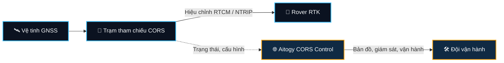

<p align="center">
  <a href="https://cors.aitogy.com/">
    
  </a>
</p>

<h1 align="center">🛰️ Aitogy CORS Control</h1>
<p align="center"><strong>Mạng lưới trạm tham chiếu GNSS · Định vị RTK chính xác · Vận hành trên một nền tảng</strong></p>

<p align="center">
  
</p>

<p align="center">
  <a href="https://cors.aitogy.com/"></a>
  <a href="https://cors.aitogy.com/network-status"></a>
  <a href="https://cors.aitogy.com/coverage"></a>
  <a href="https://cors.aitogy.com/api/docs"></a>
</p>

<p align="center">
  
  
  
</p>

## 🌌 Nền tảng CORS cho định vị chính xác

**Aitogy CORS Control** là website quản lý và theo dõi mạng lưới trạm GNSS/CORS của Aitogy. Từ bản đồ trạm và vùng phủ công khai đến dashboard vận hành thiết bị, rover và kết nối NTRIP/RTCM — thông tin mạng lưới được tập trung trong một giao diện web.

## ✨ Khám phá nền tảng

| 🗺️ Bản đồ & vùng phủ | 📡 Tình trạng mạng lưới |
|---|---|
| Khám phá vị trí, trang thông tin trạm và phân bố mạng lưới CORS. | Theo dõi thông tin hoạt động của mạng lưới và các trạm. |

| 🛰️ Vận hành CORS & rover | 🔌 Dành cho nhà phát triển |
|---|---|
| Quản lý thiết bị, rover và phiên kết nối RTK/NTRIP trong dashboard. | Tra cứu tài liệu API để tích hợp với hệ thống. |

## 🧭 Từ vệ tinh đến rover RTK



## 🧰 Công nghệ

<p>
  
  
  
  
  
  
</p>

## 🗂️ Cấu trúc repository

```text
.
├── cors_dashboard/       # Website và API: backend, frontend, source, tests
├── geodetic/             # Agent tại trạm, công cụ thiết bị và tests
├── docs/
│   ├── assets/           # Ảnh dùng trong tài liệu
│   └── specs/            # Đặc tả và thiết kế hệ thống
├── reports/
│   ├── geodetic/         # Log vận hành đã lưu
│   ├── pdf/              # Báo cáo tổng hợp
│   └── security-scan/    # Kết quả rà soát bảo mật
├── scripts/              # Build assets và self-check
└── tools/diagnostics/    # Công cụ phân tích RTCM/MQTT độc lập
```

Tài liệu chính: [đặc tả agent](docs/specs/ESP_AGENT_REPLACEMENT_SPEC.md) · [báo cáo security scan](reports/security-scan/report.md).

<p align="center">
  <a href="https://cors.aitogy.com/">🌐 Mở website</a> &nbsp;·&nbsp;
  <a href="https://cors.aitogy.com/network-status">📡 Xem trạng thái</a> &nbsp;·&nbsp;
  <a href="https://cors.aitogy.com/coverage">🗺️ Khám phá vùng phủ</a> &nbsp;·&nbsp;
  <a href="https://cors.aitogy.com/api/docs">🔌 Đọc API</a>
</p>

<p align="center">
  
</p>
