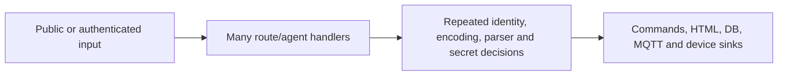

# Security Hardening Proposal: Make untrusted data safe by construction

## Decision

Treat the repeated findings as a shared-control design issue while continuing local tactical remediation.

## Executive Recommendation

Option 1 is targeted local guards; Option 2 is a shared owned boundary with common policy and regression tests; Option 3 is stronger capability or service isolation where the threat model warrants it. I recommend Option 2 first because it improves control ownership without assuming an unmeasured process split.

## Evidence

Observed evidence includes the canonical reportable findings covering device identity, station scope, command dispatch, browser sinks, parser bounds, credentials, and fail-open paths. I inspected the recorded source locations and centralized validation records; no live deployment behavior was measured.

## Current Design And Failure Mode

The current design repeats security decisions across routes, MQTT/WebSocket handlers, agents, templates, parsers, and fallback configuration. We can see the recurrence pattern: one identity is authenticated while another payload field selects the resource, or an untrusted value reaches a sink without one shared invariant.

## Desired Invariants

- The final resource identity is canonicalized once and authorization is evaluated against it.
- Untrusted bytes cannot reach command, HTML, parser, or persistence sinks without a shared boundary check.
- Secrets are unique, rotatable, redacted, and never used as ambient fallback credentials.
- Failures reject access and bound work rather than silently widening authority.

## Constraints And Non-Goals

No source changes are included in this proposal. Live services were not contacted. Compatibility, latency, memory, and operational budgets require measurement.

## Before Architecture

## Options

### Option 1: Local guards

Patch each path and add regression cases. This is fastest and preserves behavior, but control drift remains likely.

### Option 2: Shared owned boundary

Introduce shared identity, encoding, parser-limit and secret APIs. Callers pass canonical identities and receive typed safe values. We keep local checks at public boundaries, but the dangerous sinks refuse raw values. The cost is API migration and focused compatibility work; the benefit is one owner for the invariant.

### Option 3: Capability or service isolation

Move device command and secret operations behind scoped capabilities or a separate service. This gives the strongest blast-radius reduction, but adds serialization, deployment, monitoring, and rollback complexity. It becomes preferable if broker/device exposure or operational isolation is confirmed to be fleet-critical.

## Comparison

| Dimension | Option 1 | Option 2 | Option 3 |
| --- | --- | --- | --- |
| Security | Improves affected paths; drift remains | Improves recurrence resistance | Strongest containment; new boundary risk |
| Performance | Lowest change | Small validation/API cost | Extra hops and serialization |
| Memory | Neutral | Small typed/cache overhead | Extra process/queues |
| Reliability | Familiar behavior | Shared failure semantics need tests | Failure isolation improves, availability work increases |
| Operability | Minimal | Shared metrics and policy ownership | Highest deployment burden |
| Migration | Fast, reversible | Incremental adapters | Protocol/data migration required |

## Recommendation

I recommend Option 2 under current assumptions. Option 1 remains necessary as tactical protection, while Option 3 should win if measured blast radius, isolation requirements, or incident evidence outweigh the operational cost.

## Evidence Coverage And Residual Risk

The shared boundary addresses identity confusion, unsafe sinks, and secret/fail-open recurrence; each original path still needs its direct regression test. Residual risk includes legacy callers, configuration drift, and unmeasured deployment ACLs.

## Migration And Rollout

Add shared APIs, dual-run validation in logs, migrate callers by subsystem, enable fail-closed behavior behind an auditable flag, then remove legacy fallbacks. Roll back by restoring the adapter while retaining input rejection and secret rotation.

## Validation Plan

Run every original regression case, cross-station identity tests, malformed-input fuzzing with resource limits, template/command sink tests, secret-redaction checks, and representative latency/memory benchmarks.

## Implementation Work Packages

Define typed boundary APIs; migrate highest-impact command/auth paths; rotate credentials; add centralized metrics and tests; then re-run the complete scan and compare findings by stable identity.

## Open Questions

Which deployments still use legacy credentials? What are broker ACLs and device enrollment constraints? What latency and memory thresholds should gate Option 3?
